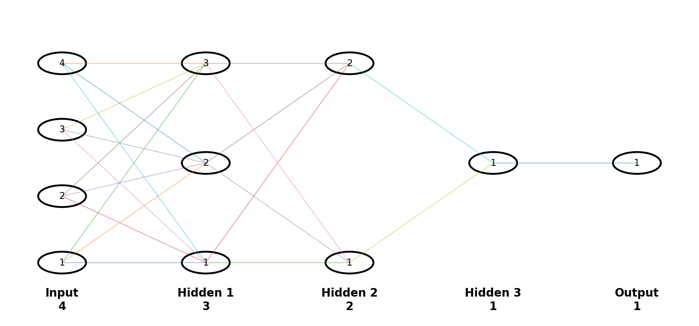
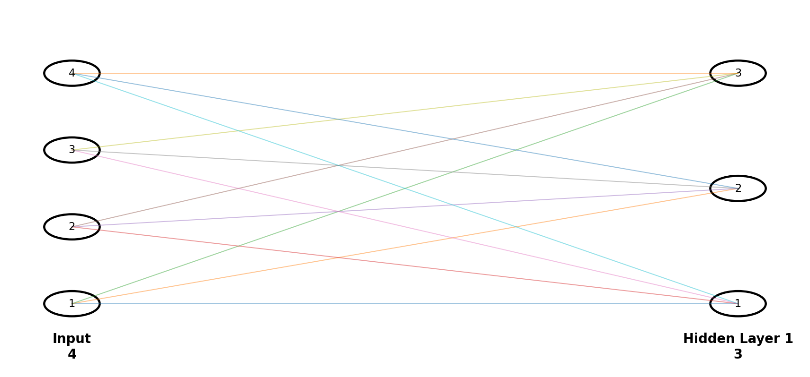
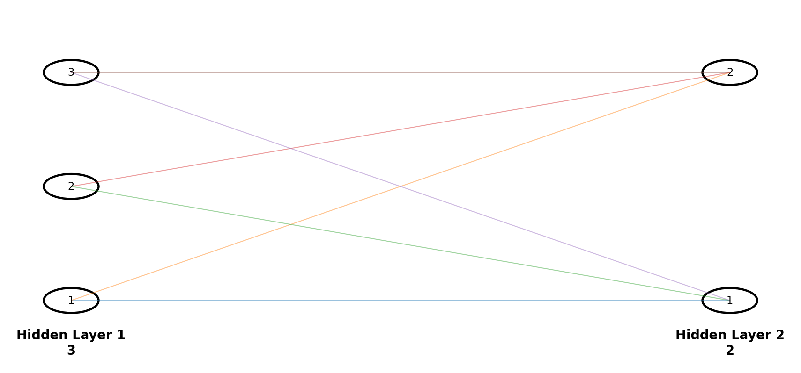
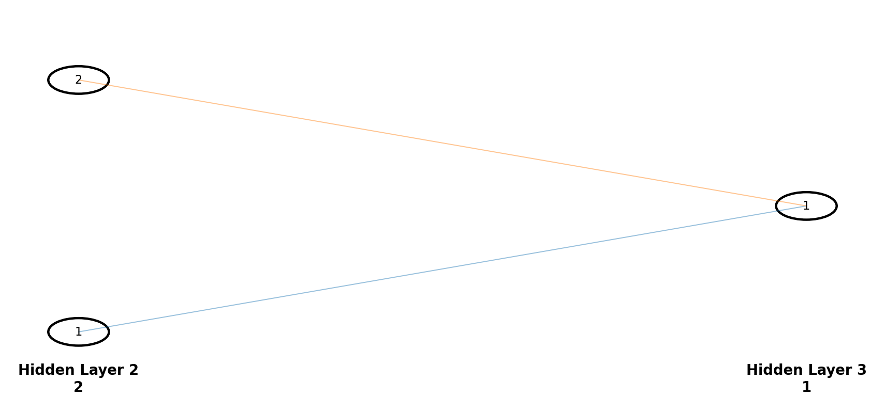
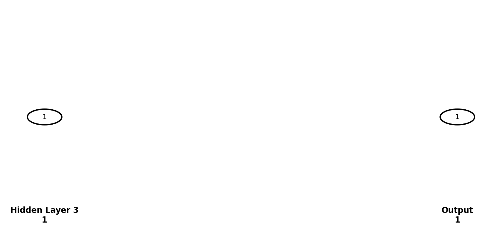

# Forward Propagation — Numerical Example

## Architecture

**Architecture:** `4 → 3 → 2 → 1 → 1`

---

# Given Input

Humare paas 4 input values hain:

$$
x_1=2,\quad x_2=3,\quad x_3=1,\quad x_4=4
$$

Column form:

$$
X=
\begin{bmatrix}
2\\
3\\
1\\
4
\end{bmatrix}
$$

---

# Step 1 — Hidden Layer 1

### Weights

$$
W^{[1]}=
\begin{bmatrix}
0.5&0.2&0.1&0.4\\
0.3&0.7&0.2&0.1\\
0.6&0.1&0.8&0.3
\end{bmatrix}
$$

### Bias

$$
b^{[1]}=
\begin{bmatrix}
0.1\\
0.2\\
0.1
\end{bmatrix}
$$

## Neuron 1

$$
Z_1^{[1]}
=(2)(0.5)+(3)(0.2)+(1)(0.1)+(4)(0.4)+0.1
$$

$$
=1+0.6+0.1+1.6+0.1
$$

$$
\boxed{Z_1^{[1]}=3.4}
$$

ReLU:

$$
A_1^{[1]}=\max(0,3.4)=\boxed{3.4}
$$

## Neuron 2

$$
Z_2^{[1]}
=(2)(0.3)+(3)(0.7)+(1)(0.2)+(4)(0.1)+0.2
$$

$$
=0.6+2.1+0.2+0.4+0.2
$$

$$
\boxed{Z_2^{[1]}=3.5}
$$

$$
A_2^{[1]}=\max(0,3.5)=\boxed{3.5}
$$

## Neuron 3

$$
Z_3^{[1]}
=(2)(0.6)+(3)(0.1)+(1)(0.8)+(4)(0.3)+0.1
$$

$$
=1.2+0.3+0.8+1.2+0.1
$$

$$
\boxed{Z_3^{[1]}=3.6}
$$

$$
A_3^{[1]}=\max(0,3.6)=\boxed{3.6}
$$

### Layer 1 Output

$$
A^{[1]}=
\begin{bmatrix}
3.4\\
3.5\\
3.6
\end{bmatrix}
$$

---

# Step 2 — Hidden Layer 2

### Weights

$$
W^{[2]}=
\begin{bmatrix}
0.4&0.5&0.2\\
0.3&0.6&0.7
\end{bmatrix}
$$

$$
b^{[2]}=
\begin{bmatrix}
0.1\\
0.2
\end{bmatrix}
$$

## Neuron 1

$$
Z_1^{[2]}
=(3.4)(0.4)+(3.5)(0.5)+(3.6)(0.2)+0.1
$$

$$
=1.36+1.75+0.72+0.1
$$

$$
\boxed{Z_1^{[2]}=3.93}
$$

$$
A_1^{[2]}=\max(0,3.93)=\boxed{3.93}
$$

## Neuron 2

$$
Z_2^{[2]}
=(3.4)(0.3)+(3.5)(0.6)+(3.6)(0.7)+0.2
$$

$$
=1.02+2.10+2.52+0.2
$$

$$
\boxed{Z_2^{[2]}=5.84}
$$

$$
A_2^{[2]}=\max(0,5.84)=\boxed{5.84}
$$

### Layer 2 Output

$$
A^{[2]}=
\begin{bmatrix}
3.93\\
5.84
\end{bmatrix}
$$

---

# Step 3 — Hidden Layer 3

### Weights

$$
W^{[3]}=
\begin{bmatrix}
0.5&0.8
\end{bmatrix}
$$

$$
b^{[3]}=0.2
$$

Calculation:

$$
Z^{[3]}
=(3.93)(0.5)+(5.84)(0.8)+0.2
$$

$$
=1.965+4.672+0.2
$$

$$
\boxed{Z^{[3]}=6.837}
$$

ReLU:

$$
A^{[3]}=\max(0,6.837)
$$

$$
\boxed{A^{[3]}=6.837}
$$

---

# Step 4 — Output Layer

### Weight

$$
W^{[4]}=
\begin{bmatrix}
0.9
\end{bmatrix}
$$

### Bias

$$
b^{[4]}=0.1
$$

Calculation:

$$
Z^{[4]}=(6.837)(0.9)+0.1
$$

$$
=6.1533+0.1
$$

$$
\boxed{Z^{[4]}=6.2533}
$$

---

# Step 5 — Sigmoid

Ab output neuron par sigmoid lagayenge:

$$
\hat y=\frac{1}{1+e^{-Z^{[4]}}}
$$

$$
\hat y=\frac{1}{1+e^{-6.2533}}
$$

$$
\boxed{\hat y\approx0.9981}
$$

Classification ke liye threshold `0.5` lete hain:

$$
0.9981>0.5
$$

Isliye:

$$
\boxed{\text{Predicted Class}=1}
$$

---

# Complete Numerical Flow

$$
X=
\begin{bmatrix}
2\\3\\1\\4
\end{bmatrix}
$$

$$
\Downarrow
$$

$$
Z^{[1]}=
\begin{bmatrix}
3.4\\3.5\\3.6
\end{bmatrix}
$$

$$
\Downarrow\quad ReLU
$$

$$
A^{[1]}=
\begin{bmatrix}
3.4\\3.5\\3.6
\end{bmatrix}
$$

$$
\Downarrow
$$

$$
Z^{[2]}=
\begin{bmatrix}
3.93\\5.84
\end{bmatrix}
$$

$$
\Downarrow\quad ReLU
$$

$$
A^{[2]}=
\begin{bmatrix}
3.93\\5.84
\end{bmatrix}
$$

$$
\Downarrow
$$

$$
Z^{[3]}=6.837
$$

$$
\Downarrow\quad ReLU
$$

$$
A^{[3]}=6.837
$$

$$
\Downarrow
$$

$$
Z^{[4]}=6.2533
$$

$$
\Downarrow\quad Sigmoid
$$

$$
\boxed{\hat y=0.9981}
$$

$$
\boxed{\text{Class}=1}
$$

---

# Final Numerical Summary

| Stage | Calculation | Output |
|---|---|---:|
| Input | $X$ | $[2,3,1,4]^T$ |
| Hidden 1 | $W^{[1]}X+b^{[1]}$ | $[3.4,3.5,3.6]^T$ |
| ReLU | $\max(0,Z^{[1]})$ | $[3.4,3.5,3.6]^T$ |
| Hidden 2 | $W^{[2]}A^{[1]}+b^{[2]}$ | $[3.93,5.84]^T$ |
| ReLU | $\max(0,Z^{[2]})$ | $[3.93,5.84]^T$ |
| Hidden 3 | $W^{[3]}A^{[2]}+b^{[3]}$ | $6.837$ |
| ReLU | $\max(0,6.837)$ | $6.837$ |
| Output | $W^{[4]}A^{[3]}+b^{[4]}$ | $6.2533$ |
| Sigmoid | $\frac{1}{1+e^{-6.2533}}$ | **0.9981** |
| Prediction | $0.9981>0.5$ | **Class 1** |

---

# Ek Line Mein Pura Calculation

$$
\boxed{
[2,3,1,4]
\rightarrow
[3.4,3.5,3.6]
\rightarrow
[3.93,5.84]
\rightarrow
6.837
\rightarrow
6.2533
\rightarrow
0.9981
\rightarrow
\text{Class 1}
}
$$
